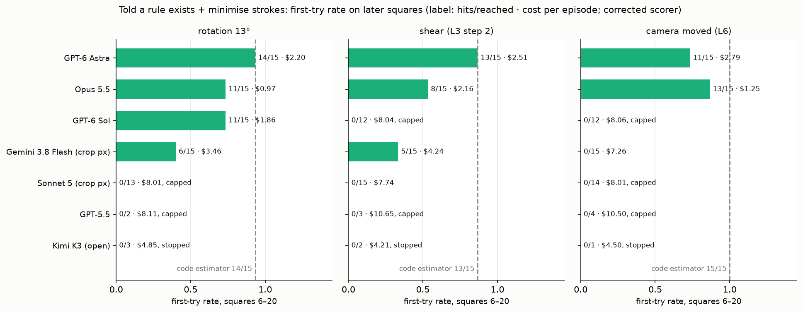

# Freehand

**Does an agent learn a silently changed tool from the consequences of its own strokes, or does it patch each
mistake locally?**

An agent draws on a simulated page with a pen plotter and sees the result through a camera. The page holds
hand-drawn squares, each missing one side. The agent closes them one at a time, one straight stroke per turn,
commanding endpoints in page millimetres. A stroke closes a square if its ink lands within 2 mm of both free ends.
Ink is permanent. Partway through, the tool silently changes: the plotter's map shifts, rotates, shears, lags,
mirrors or warps, or the camera moves. Nobody tells the agent.

Local patching still gets every square closed: miss, look at the gap, correct. So Freehand scores **transfer**, not
completion. The primary measure is the first-try learning curve after the change. Did each new square close on its
*first* stroke? That only happens reliably once the agent has a model of the change. The curve is reported with
strokes, wasted ink, tokens and cost, and compared with code reference agents on the same pages: an oracle, a naive
agent, ideal estimators, a local patcher, a Broyden secant and a library learner.

Models are called through OpenRouter with reasoning forced on. The benchmark data is frozen and seeded: the same
suite and seed produce identical pages, targets, rules and change schedule on any machine.

> Status: research code. A historical record of pilot studies (2026-09-27/28) plus a frozen v1 benchmark, and not
> yet an externally reviewed release. Claim boundaries: [docs/findings.md](docs/findings.md).
> **LICENSE: TODO**: no license has been chosen yet (the owner's decision).
>
> **This repository is the single source of truth.** The two earlier folders, the working copy
> (`~/Desktop/strokes_research/freehand_b`) and the Codex publication copy
> (`~/Documents/Codex/2026-09-27/anal/outputs/freehand_publish`), are read-only archives superseded by this repo.
> Their code, results, documents and cache are all imported here ([docs/MIGRATION.md](docs/MIGRATION.md)); they are
> kept, not deleted, because the imported runs link to their images and videos.

## Results so far



Told that "the tool may be perturbed ... always following a consistent rule; deduce it" and to minimise strokes,
GPT-6 Astra and Claude Opus 5.5 fit the silent change and hit most later squares on the first stroke under a 13°
rotation, a shear and a moved camera. GPT-6 Sol does so on rotation only (11/15). Gemini 3.8 Flash fits late
(6/15, 5/15, 0/15). Sonnet 5, GPT-5.5 and Kimi K3 get no first-try hits after the change. Without the hint, Opus
patched each square locally instead (rotation 2/9). In the camera-only condition no model's notes mention the camera.

**Caveats.** One seed (one page), one episode per cell, pilot budgets: several cells are capped or stopped, and Kimi
K3 failed the basic-task gate, so its cells are descriptive only. This is a spread of behaviours, not a ranking.
Details, quotes and boundaries: [docs/findings.md](docs/findings.md); all figures: [docs/figures/](docs/figures/).

## Documentation

| Doc | What it holds |
|---|---|
| [docs/findings.md](docs/findings.md) | Current, conservative findings and claim boundaries |
| [docs/HISTORY.md](docs/HISTORY.md) | Chronological journal: every phase, design, result, correction, and spend by run |
| [docs/preregistration.md](docs/preregistration.md) | The preregistration and Addenda 1–13, verbatim, with provenance |
| [docs/benchmark_ladder.md](docs/benchmark_ladder.md) | The historical results document (ladder, hacking finding, pilots, informed_models) |
| [docs/roadmap.md](docs/roadmap.md) | Status and plan: one_shot mode, the v1 model study, Freehand A, coloured pens |
| [docs/perturbations.md](docs/perturbations.md) | Implemented rules, and the 28-rule design document |
| [docs/method.md](docs/method.md), [docs/architecture.md](docs/architecture.md), [docs/results_format.md](docs/results_format.md) | Method, code layout, results format |
| [docs/quote_bank/](docs/quote_bank/) | Quote bank data, generator and curated highlights |
| [docs/related_work.md](docs/related_work.md) | Related work (Codex copy) |
| [docs/MIGRATION.md](docs/MIGRATION.md) | How the two copies became this repo; verification; open decisions |
| [docs/archive/](docs/archive/) | Superseded documents, verbatim |

Media (historical videos and charts, 43 MB) are kept out of git in `results/media/` (see its README).

---

## Install

Python 3.12 (pinned; the golden hashes were produced with 3.12). From a clone:

```sh
python3.12 -m venv .venv
.venv/bin/pip install -e ".[dev]"          # or: pip install --require-hashes -r requirements.lock && pip install -e . --no-deps
.venv/bin/freehand --help
```

To call models, put your OpenRouter key in the environment or in `<repo>/.env` (gitignored; see `.env.example`):

```sh
echo 'OPENROUTER_API_KEY=sk-or-v1-...' > .env
```

The key is read only from `OPENROUTER_API_KEY` or `<repo>/.env`, only when a live call is needed. It is never
printed or logged. Cached requests replay without a key.

## Quickstart

```sh
freehand run smoke --fake-models                 # offline: the whole pipeline with a scripted fake model, $0
freehand ls                                      # the run you just made
freehand report results/smoke/<run_id>           # tables + charts in results/smoke/<run_id>/report/
freehand replay results/smoke/<run_id> --render  # re-simulate every stroke and regenerate every image
```

One real model on a tiny episode (4 squares; about $0.05 with Gemini 3.8 Flash):

```sh
freehand episode --model flash --suite smoke-v1 --seed 1 --perturbation rot13 --tag repo_smoke --max-usd 1.50
```

`--model` takes a registry id (`freehand models`) or **any OpenRouter slug**, e.g. `--model qwen/qwen4-vl`.
Unregistered slugs run with the registry defaults (reasoning effort high, 8000 tokens, automatic provider routing),
prices from OpenRouter's models API, and a warning.

## Run the benchmark

```sh
freehand run core-v1 --model <id-or-slug> --max-usd 20          # held-out test seeds (report these)
freehand run core-v1 --model <id-or-slug> --split dev           # development seeds (tune on these)
freehand run core-v1 --dry-run                                   # the plan: cells, settings, suite hashes; no calls
freehand report results/core-v1/<run_id>
```

| Suite | What it measures |
|---|---|
| `core-v1` | 20 squares visited far apart, change after square 4. Rules: identity control, 13° rotation, scale+shear, a bumped camera under a stale rectification, latent mirror mode, smooth warp. Arms: memory + "a consistent rule exists, minimise strokes", and stateless with landed ends as numbers. |
| `discriminating-v1` | Rules where local patching fails: command memory, latent mirror mode, smooth warp and a control. Hidden per-seed change time. Image vs image + numeric feedback. |
| `camera-v1` | Freehand A: raw uncalibrated camera view; the camera moves after square 4 (`transfer`) vs the same squares at the new pose (`fresh`). |
| `smoke-v1` | 4 squares, for smoke tests. |
| `legacy-*-v0` | Regenerate the historical pilot pages bit for bit, so old results stay comparable. |

An experiment is a YAML file in `configs/experiments/`: models × arms × rules × suite seeds, plus budget. Every
historical study is one (`pilot2`, `hard_pilot`, `ladder`, `objective_pilot`, `informed_pilot`, `stateless_pilot`,
`informed_models`, `model_study`, `controls`, `baseline_study`, ...). `freehand run <name>` runs it.
`--resume <run_dir>` finishes the stopped and not-run cells in place.

## How results are saved

Results live outside git, in `./results/` (gitignored) or wherever `FREEHAND_RESULTS` points:

```
results/
├── index.jsonl                      # append-only: one line per run event (started / finished / imported)
├── ledger.sqlite                    # every paid call: cost, budget tag, run id
├── cache/llm_cache.sqlite           # request cache shared by all runs (hits cost $0; the history is merged in)
├── <experiment>/<run_id>/           # run_id = UTC timestamp + config hash, e.g. 20260928T231252Z-f6e0f4
│   ├── manifest.json                # git commit + dirty flag, source hash, config, suites + data hashes, seeds,
│   │                                #   models + slugs + reasoning, package versions, budget/spend, EVERY cell's status
│   ├── config.yaml                  # the config exactly as run
│   ├── run.log
│   ├── episodes/<agent>/<rule>__<arm>/s<seed>/
│   │   ├── episode.jsonl            # one line per turn: prompt (state text, image hashes), reply (text, notes,
│   │   │                            #   reasoning, tokens, cost), command, landed ends, closure
│   │   ├── summary.json             # status, first-try scores, metrics, ink, tokens, cost, the system prompt
│   │   └── images/                  # only with --save-images (`freehand replay --render` regenerates them)
│   └── report/                      # `freehand report`: summary.csv/json, report.md, charts
└── legacy/<copy>/<runs|publication>/<run>/   # historical runs (`freehand import-legacy`), converted + `original` symlink
```

Formats and JSON Schemas: [docs/results_format.md](docs/results_format.md). `freehand validate <run_dir>` checks
a run against them.

## Seeds and suites

A suite (`configs/suites/<id>.yaml`) freezes the page generator, the change schedule, the named rules with
their parameters, and explicit **dev** and **test** seed lists. Every random draw comes from a named substream of
the seed (`freehand.seeding`), so adding a rule never changes an existing page. Each suite file stores a
`data_hash` of everything it generates:

```sh
freehand suite list
freehand suite verify --all --oracle     # recompute every hash; check the oracle can reach every target
freehand suite show core-v1 --seed 1005  # the page, targets, rules and schedule of one seed
```

To build a new suite: write the YAML with empty seeds, then `freehand suite scan <id> --start N --count K` (a
feasibility filter only) and `freehand suite freeze <id>`. A suite is never edited after results exist. Make
`<id>-v2` instead.

## Models

`configs/models.toml` is the registry. Each entry has a short id, the OpenRouter slug, provider pinning, the
reasoning parameters, prices, a default answer mode (`page_mm`, `crop_px` or `auto`) and notes. `freehand models`
prints it. To add a model, add a `[models.<id>]` table. Experiments can override reasoning / max_tokens / provider
/ output_mode per model; that is how the historical settings are reproduced.

## Adding a perturbation

Subclass `freehand.perturbations.Perturbation`, give it a `type_name` and a frozen `Params` dataclass, and
implement `expected(pts, n)` (noise-free landing) and `oracle_cmd(target, n)`. Keep state changes in `land()`.
Register it in `perturbations/__init__.py`, then use it in a new suite version. Random parameters must come from a
new named stream in `freehand/seeding.py`. See [docs/perturbations.md](docs/perturbations.md).

## Reproducing past results

```sh
freehand import-legacy --source working=<path to freehand_b> --source codex=<path to freehand_publish> --merge-cache
freehand replay results/legacy/working/runs/objective_pilot_20260927_220713 --render
freehand rescore results/legacy/working/runs/objective_pilot_20260927_220713
freehand run objective_pilot --max-usd 0          # re-run a historical study from the merged cache, at $0
freehand figures results/legacy/working/runs/{informed_pilot,informed_models,objective_pilot,stateless_pilot}_* \
    --out docs/figures                           # the study figures (add --scorer legacy for the historical scores)
```

The new episode loop reproduces the historical code exactly. The same arm and turn send byte-identical requests
(`tests/test_legacy_parity.py`: 150 cases, every arm, rule and reference agent). Every imported historical episode
(1,901, including informed_models) replays exactly, and the images the models saw regenerate bit for bit. Details:
[docs/MIGRATION.md](docs/MIGRATION.md).

## Costs and budgets

Every paid call is recorded in `results/ledger.sqlite` under the experiment's budget tag. Budgets are enforced in
code, not on trust:

- **Tag cap** (`budget.cap_usd`). Before a call, the worst case (all input uncached + max output at list price,
  +25%) is reserved. The call is refused if spend + in-flight + worst case would pass the cap. The reservation is
  released only after the cost is recorded.
- **`--max-usd X`** caps new spend for this invocation.
- **Balance check.** Before a paid run the cap is lowered to what the OpenRouter balance *and* the API key's own
  lifetime limit still cover.
- **Episode cap** (`budget.episode_cap_usd`). An episode stops as `capped` (inconclusive, not failed) once its
  calls have cost this much at their original price.

A budget stop keeps every planned cell in the manifest as `not_run_budget`, never silently dropped. The caps are
local estimates, not provider-enforced limits.

## Repository map

```
configs/          models.toml, suites/*.yaml (frozen data), experiments/*.yaml (studies)
src/freehand/
  seeding.py      named random substreams
  sim/            page, plotter landing model, rendering, Freehand A camera
  perturbations/  the rule registry (calibration tier, discriminating tier, camera)
  suites/         suite files -> deterministic data, hashes, episode setup
  agents/         arms, prompt assembly, prompts/v1 (versioned text), LLM agent, reference agents
  llm/            OpenRouter client, request cache, ledger + budgets, registry, secrets
  episode/        world state, the loop, turn/summary records
  scoring.py      first-try scoring (interrupted squares counted correctly)
  metrics/        episode metrics, ink, regret
  experiments/    config -> cells -> the one generic runner
  results/        run tree, manifests, index, JSON Schemas
  replay.py       re-simulation and image regeneration
  analysis/       reports, charts, study figures, quote bank, rescoring
  legacy/         historical import, suite matching, cache/ledger merge
  cli.py          the `freehand` command
tests/            ported + new tests; fixtures/legacy_parity.json.gz (recorded from the original code)
docs/             findings, HISTORY, preregistration, roadmap, method, architecture, figures/, quote_bank/, archive/
```

More: [findings](docs/findings.md) · [history](docs/HISTORY.md) · [architecture](docs/architecture.md) ·
[method](docs/method.md) · [preregistration](docs/preregistration.md) · [roadmap](docs/roadmap.md) ·
[migration](docs/MIGRATION.md)
