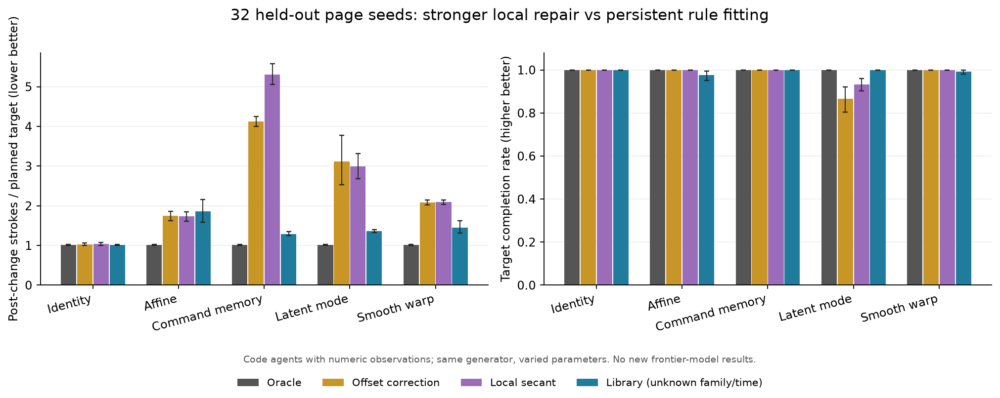

# Continued publication work — September 28

The latest user request resumed active work at approximately 15:47 UTC. Everything below was executed in the separate working copy. No background automation or new paid model run is claimed.

## Main result

**Command memory remains the strongest candidate after strengthening the controls.** On 32 previously unused page seeds, a numeric-observation baseline that is not told the true family or change time completed every command-memory and latent-mode target. It detects deviations and selects from an explicit six-family library.

| Condition | Offset correction: strokes/target | Local secant: strokes/target | Library: strokes/target | Library target completion |
|---|---:|---:|---:|---:|
| Identity | 1.03 | 1.03 | 1.02 | 100.0% |
| Affine | 1.74 | 1.74 | 1.86 | 97.5% |
| Command memory | 4.13 | 5.31 | 1.29 | 100.0% |
| Latent mode | 3.12 | 3.00 | 1.36 | 100.0% |
| Smooth warp | 2.09 | 2.09 | 1.45 | 99.2% |

The paired command-memory difference between the library and offset correction is -2.83 strokes/target, with a descriptive seed-bootstrap interval of [-2.97, -2.69]. Against local secant correction it is -4.01 [-4.29, -3.75]. These are within-generator code-agent results, not evidence of frontier-model difficulty or a universal learning advantage.

The affine and warp failures matter: persistent model fitting is not uniformly superior, and a high first-try rate alone can hide failures on later targets. The evaluated version was not retuned to remove these failures.

## What ran

- Two preserved four-seed development passes: **112 episodes each**. The first exposed false change alarms and a model-selection defect after polyline commands. The second fixed those before the new-seed evaluation.
- Frozen new-seed evaluation: **896 episodes**, 32 seeds (3001–3032), five condition families, varied change timing and transform parameters. No page-generation failures, no stopped episodes, and every oracle target closed without clamping.
- Full fake-model workflow smoke: **one rendered 12-target episode**, completed. Its accounting is synthetic; actual API charges were zero.
- Oracle preflight for the planned model study: **12 configurations**, all targets reachable without clamping.

Development results and revisions remain available, not silently replaced. The "held-out" designation concerns page seeds and parameter realizations from the same generator. It is not held-out rule families, visual domains, or external validation.

## Engineering and verification

- Numeric controller observations exclude seed, family, change flags and hidden state. Regression tests enforce that boundary.
- Added a bounded, damped Broyden secant controller that forgets between targets, and an adaptive library controller that fits across targets.
- Added image-versus-image-plus-numeric model arms with the same non-secret numeric schema.
- Added a plan-only model runner, explicit execution mode, isolated ledgers, ordered budget reservation recording, per-episode gates, and an index retaining every planned/stopped/not-run cell.
- Created a fresh Python environment from cached dependencies and generated a fully pinned dependency lock with distribution hashes. **24 tests pass in the fresh environment.** An integer-array casting bug exposed by the tests was fixed; the floating-point study observations were unaffected.
- **6,558 decisions across 320 library/secant episodes were regenerated exactly** after the integer-input fix, verifying that the current controllers reproduce the frozen new-seed results.
- **1,121 additional episodes / 27,488 strokes replay exactly**, covering both development passes, the new-seed evaluation and fake workflow smoke. Prior verification separately covered 716 episodes / 20,648 strokes.

## Publication decisions

Promote command memory and latent mode as the two candidate extensions for model testing. Retain smooth warp as a diagnostic; its local-repair cost is smaller. Keep identity and affine conditions as controls. Report completion alongside interaction cost; never call the library an optimum or claim it has the same prior knowledge as an image-only model.

The current draft positioning is adaptation during an ongoing task with permanent action consequences and next-target transfer. Related work already evaluates hidden-law discovery and controlled priors; see RELATED_WORK.md. No claim of being the first such evaluation is supported.

## Ready artifacts and remaining work

- `publication/baseline_holdout/REPORT.md`, `summary.json`, `rows.json`: new-seed results and paired comparisons.
- `publication/baseline_holdout/source/`: frozen source, supplemented with the unchanged calibration asset.
- `publication/decision-reproduction.json`: command-level verification.
- `publication/model_plan/manifest.json`: 48-cell prospective model plan.
- `publication/model_preflight/summary.json`: oracle feasibility checks.
- `MODEL_STUDY.md`: execution and interpretation guide.
- `requirements.lock`: dependency versions and hashes.

Paid model evaluation still needs a dollar budget separate from Codex usage. No paid calls were initiated. External publication, license selection, hardware validation and independent scientific review remain outstanding. A local review bundle is a review artifact, not a public release or license grant.

## Review artifact validation

The compact local review archive was extracted into a different directory. All 138 allowlisted file hashes matched its manifest; all 24 tests passed there using the fresh environment, and a 15-episode offline reproduction subset completed. A separate evidence archive includes the 1,360 code-control episodes from the original control study, both development passes and the 32-seed evaluation. No historical model response database, credentials or copied runtime is included.

Strict `--require-hashes` installation into a second empty environment could not finish offline: the cache contained the unpacked OpenCV distribution but not its original wheel archive for hash validation. The successful fresh-environment test used cached distributions installed from the exact observed-version requirements. Thus dependency versions and archive contents are verified locally, while hash-enforced installation from a package index remains unverified. Other platforms remain untested.
