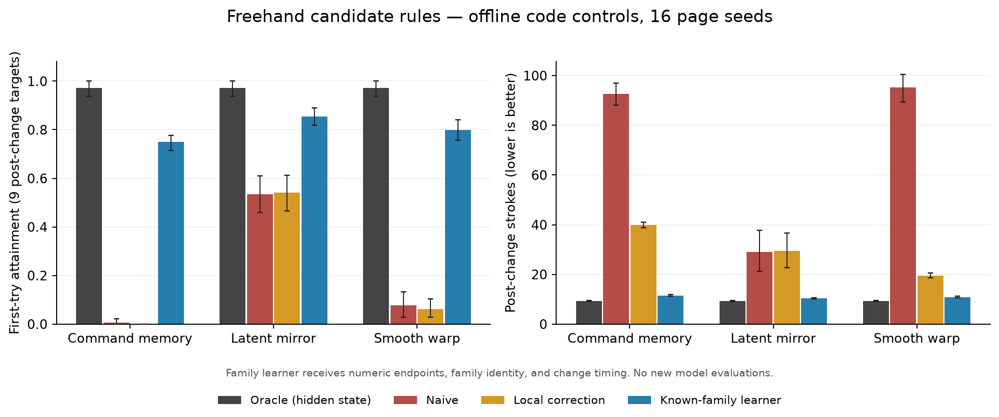

# Freehand publication-development report

Later work is documented in [CONTINUATION_REPORT.md](CONTINUATION_REPORT.md), including stronger baselines, 32 new page seeds, and clean-environment validation. The counts below describe the earlier work only.

**Work performed September 28, 2026 after resuming at 12:17 UTC. The planned overnight continuation did not run.** The directory copy completed overnight, but the automation was not registered. The changes and experiments below were performed after the user's follow-up; they must not be represented as eight hours of research.

## Verified changes

- A separate copy exists in this directory. A SHA-256 comparison against the recorded source manifest found no changed original source files.
- The simulator now carries its grid renderer and calibration asset locally. It imports successfully without the neighboring hardware folder.
- The objective summary retains separate page seeds and rejects conflicting repetitions instead of silently dropping them. Reference matching now includes the seed. Charts combine the included seed curves rather than displaying only the first seed.
- First-stroke scoring includes an observed failed attempt even if an episode stops before the square's final record is written. Unknown targets remain unknown; coverage and fixed-budget attainment are separate fields.
- Nonfinite command coordinates are rejected. Scenario changes scheduled before the first target are now activated. Offline rendering can be disabled for code agents only; a regression test verifies rendering does not alter commands or ink.
- Replay now reconstructs both original scenarios and stateful new scenarios. It checks endpoint positions and closure outcomes.
- Three candidate perturbations, a local-correction baseline, a known-family learner, a no-network experiment runner, and source-hashed manifests were added.
- README and key findings now distinguish exploratory evidence, privileged controls, historical claims, and unfinished validation. Historical narrative documents carry a supersession notice.

## Completed experiments

**240 code-agent episodes across 16 fixed page seeds.** No page-generation failures; no stopped episodes. The oracle completed all nine post-change targets in every condition and seed with no command clamping. This is an empirical solvability check on the tested pages, not a proof for all possible pages.

| Rule | Local correction: post strokes | Known-family learner: post strokes | Oracle: post strokes |
|---|---:|---:|---:|
| Persistent command dynamics | 39.88 | 11.50 | 9.25 |
| Latent mirror state | 29.44 | 10.38 | 9.25 |
| Smooth cross-axis warp | 19.50 | 10.88 | 9.25 |

Each page has nine post-change targets. Some agents fail to complete targets despite spending more strokes; see the complete result table. Command dynamics and latent mode are the more promising next model experiments. Smooth warp is retained as a diagnostic candidate, not promoted as an equally strong difficulty increase.

The known-family learner has numeric target/end-point access and knows the family and change timing. It does not know the sampled hidden parameters. Its comparison with local correction isolates the value of persistent rule fitting under those privileges. **These are not new LLM results.**

## Verification

- **13 regression tests passed**, including interrupted scoring, seed preservation, state transitions, inverse commands, finite inputs, and rendered/headless equivalence.
- **716 episodes / 20,648 strokes replayed exactly**: all endpoint positions matched to less than 1e-6 mm and every closure verdict matched. This includes 476 copied historical episodes and 240 new control episodes.
- The scoring audit identified one historical stopped episode whose conditional first-try score changes from **1/3 to 1/4**, because its failed first stroke on the interrupted square was previously excluded. Its coverage is 4/16 targets; fixed-budget attainment is 1/16. These are distinct quantities.
- New code compiles. The control figure was generated and visually inspected. No new API requests or paid model calls were made.

## Reproduce and inspect

- `publication/control_study/manifest.json`: frozen specification and source hashes at experiment start.
- `publication/control_study/REPORT.md`: per-condition means and descriptive seed-bootstrap intervals.
- `publication/control_study/rows.json`: per-seed results.
- `publication/control_study/episodes/`: commands, dense ink, metadata and outcomes.
- `publication/replay-audit.json`: episode-level consistency and scoring audit.
- `publication/test-results.txt`: test output.
- `publication/source_unchanged_check.json`: original-source comparison.
- `PUBLICATION_PLAN.md`: frozen replication proposal and interpretation limits.

## Remaining publication gates

1. Evaluate actual models on frozen held-out pages; include a numeric-feedback arm to distinguish perception from learning. Current controls cannot substantiate frontier-model difficulty.
2. Compare to a stronger local secant/Newton strategy and an equally informed general system identifier. Current family knowledge is privileged and the local patcher is deliberately simple.
3. Validate camera attribution behaviorally; the historical regex is only a keyword screen. Remove causal/mechanistic claims based solely on wording in rationales.
4. Verify a fresh-environment install, sanitize an intentional public artifact manifest, choose a license, and document model-adapter configuration. The copied runtime, cache, and historical media are not a proposed public bundle.
5. Broaden target geometry before claiming spatial generalization; current control pages use a central restricted region to ensure inverse reachability.

The project is better instrumented and has validated candidate mechanics. It is not yet ready for a claim that the new tasks defeat frontier models, and nothing has been published externally.
